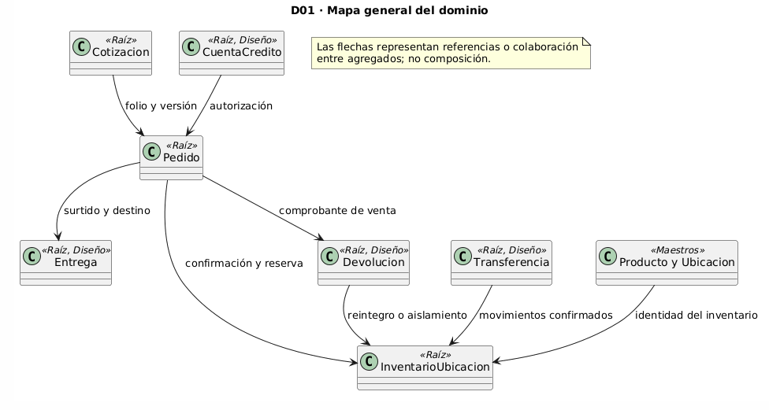
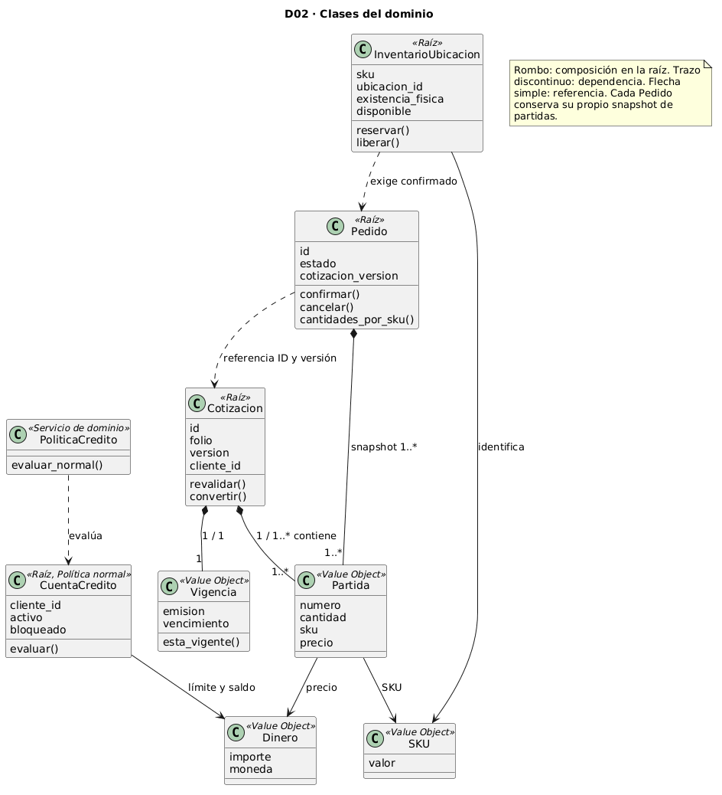
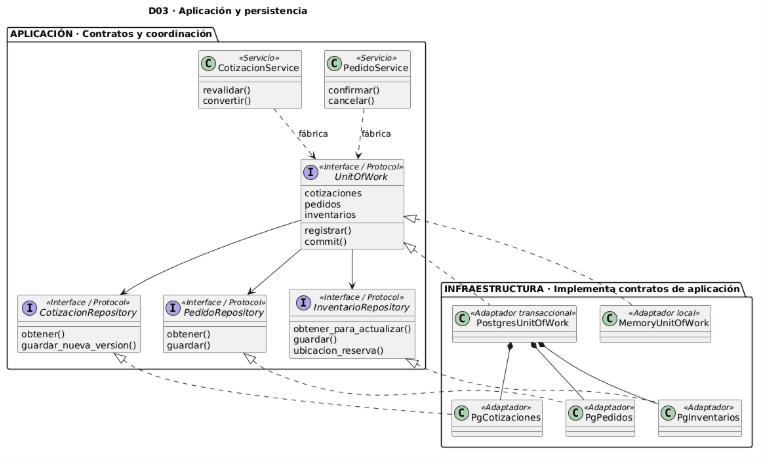
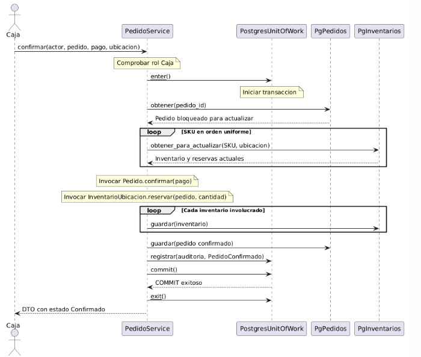
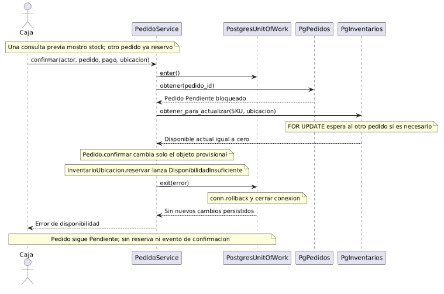

# Diagramas UML del informe final

Las cinco vistas siguientes corresponden al [informe final del equipo](U3Ferremax_Informe.pdf). Las imágenes PNG se extraen del propio PDF. Los archivos PlantUML se reconstruyeron visualmente para conservar una fuente editable; los SVG derivados pueden tener otra distribución. Véase la [procedencia y reproducción](../diagrams/README.md).

## D01 · Mapa general del dominio · página 12

Cotizacion, Pedido, CuentaCredito, InventarioUbicacion, Transferencia, Entrega y Devolucion son raíces de agregados. Producto y Ubicacion representan maestros. Las flechas expresan referencias o colaboración, sin unirlos en un solo agregado. Crédito, transferencia, entrega y devolución conservan su alcance de diseño general.

[PlantUML](../diagrams/D01.puml) · [SVG](../diagrams/D01.svg) · [PDF](../diagrams/D01.pdf)

## D02 · Clases del dominio · página 17

Las raíces y sus Value Objects conservan los nombres del prototipo. Partida es un registro inmutable del código mínimo y cada Pedido conserva su snapshot. PartidaPedido con estados de surtido corresponde al diseño completo. La composición se limita al interior de la raíz; las dependencias entre raíces no autorizan modificaciones directas de sus colecciones.

[PlantUML](../diagrams/D02.puml) · [SVG](../diagrams/D02.svg) · [PDF](../diagrams/D02.pdf)

## D03 · Aplicación y persistencia · página 18

Los servicios dependen de UnitOfWork y de los contratos de Repository. Infraestructura los implementa mediante los adaptadores PostgreSQL y Memory. D02 y D03 son vistas complementarias. Los contratos lectores y handlers CQRS se detallan en el informe; Memory facilita la revisión local y no representa otra base de producción.

[PlantUML](../diagrams/D03.puml) · [SVG](../diagrams/D03.svg) · [PDF](../diagrams/D03.pdf)

## D04 · Confirmación y reserva · página 19

La secuencia principal conserva la comprobación del rol Caja, la transacción, las lecturas con bloqueo, las invocaciones al dominio y el guardado conjunto de pedido, reservas, auditoría y evento. El DTO confirmado se devuelve después del commit. Los eventos se registran en outbox; el consumidor externo sigue pendiente.

[PlantUML](../diagrams/D04.puml) · [SVG](../diagrams/D04.svg) · [PDF](../diagrams/D04.pdf)

## D05 · Rechazo por última unidad comprometida · página 20

Una disponibilidad consultada antes puede cambiar. La operación vuelve a leer el inventario bloqueado, detecta la insuficiencia y revierte los cambios provisionales. El pedido permanece Pendiente y no se persiste un evento de confirmación. Esta secuencia no demuestra una prueba con dos conexiones PostgreSQL: ese ensayo permanece pendiente. La atención financiera de un pago ya autorizado requiere la política pendiente H05 (HC3 en el informe final).

[PlantUML](../diagrams/D05.puml) · [SVG](../diagrams/D05.svg) · [PDF](../diagrams/D05.pdf)
