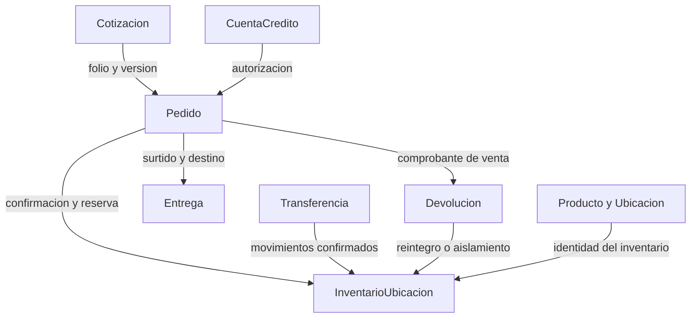
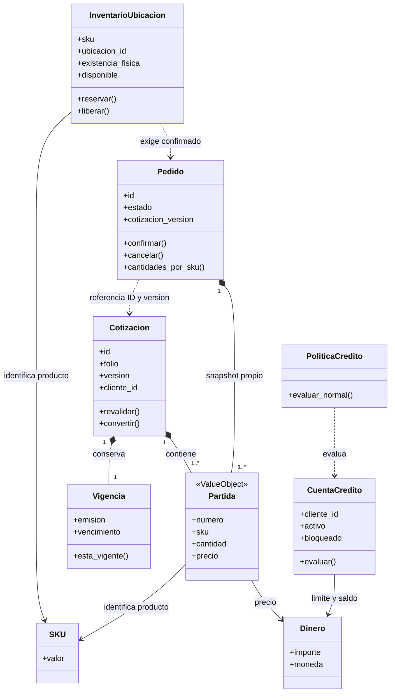
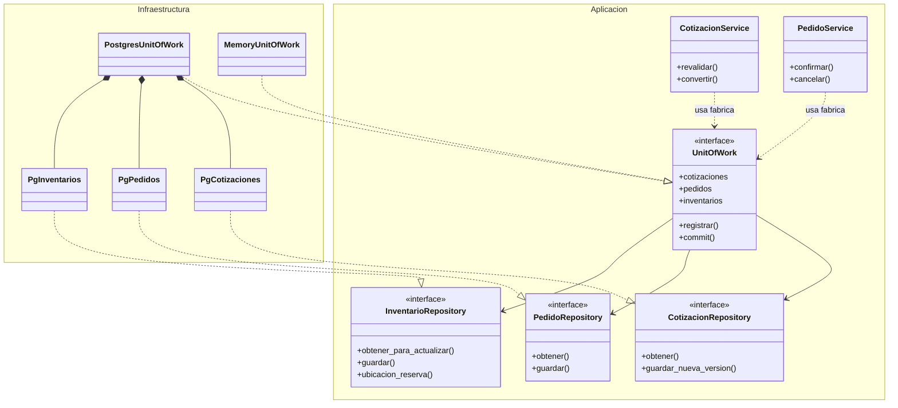
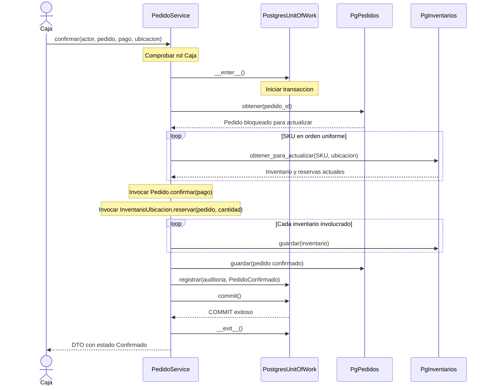

## Lectura y estado
Fuentes Mermaid editables de los diagramas propuestos. D02 y D03 constituyen dos vistas complementarias del diagrama de clases: dominio y contratos de aplicación/persistencia. Las secuencias usan los mismos nombres de clases que el código.
Se adjuntan exportaciones PDF/PNG y vistas vectoriales SVG, además de las fuentes Mermaid. BPMN de U2 revisado visualmente; véase H07.
## D01 Mapa general de dominio
Los siete nodos Cotizacion, Pedido, CuentaCredito, InventarioUbicacion, Transferencia, Entrega y Devolucion son raíces de agregados propuestos. Producto y Ubicacion representan datos maestros. Las flechas indican referencias o colaboración, no composición en un único agregado. Crédito, transferencia, entrega y devolución son diseño general; el prototipo implementa el recorrido comercial y las reservas.

## D02 Clases del dominio detallado
Cotizacion, Pedido e InventarioUbicacion son raíces. En el código mínimo Partida es un registro de valores inmutable; su número indica posición dentro del agregado. La entidad PartidaPedido con estados de surtido pertenece al diseño completo y aún no se implementa. Vigencia, Dinero y SKU son Value Objects. Las reservas están contenidas por InventarioUbicacion como colección por pedido. Las referencias entre raíces no autorizan cambios directos en sus colecciones.

## D03 Clases de aplicación y persistencia
Se lee junto con D02: los servicios obtienen objetos del dominio mediante los contratos mostrados aquí. Los Protocol de Python aparecen como interfaces UML. El dominio está separado en D02; aplicación e infraestructura están diferenciadas por namespaces. Las consultas tienen handlers y contratos lectores propios descritos en el informe. El código Memory es un adaptador para revisión local; no representa una segunda base de datos de producción.

## D04 Flujo principal de confirmación y reserva
Los participantes corresponden a clases de D03. Los objetos de dominio se muestran como invocaciones explícitas en notas para mantener cinco participantes. Las lecturas y escrituras usan la misma conexión del UoW. PedidoConfirmado se guarda en outbox junto con pedido, reservas y auditoría; la publicación externa ocurre en un componente posterior aún no implementado.

## D05 Rechazo por última unidad ya comprometida
No se demuestra con esto que cualquier configuración de PostgreSQL ya esté validada. Es la secuencia propuesta para AC-US09-02 y RNF02. La prueba local de competencia pasó con Memory; falta el ensayo con dos conexiones reales. Si Caja ya registró un pago autorizado, la respuesta financiera necesita la política pendiente H05; no se inventa un reembolso.
```mermaid
sequenceDiagram
    actor Caja
    participant Servicio as PedidoService
    participant UoW as PostgresUnitOfWork
    participant Pedidos as PgPedidos
    participant Inventarios as PgInventarios
    Note over Caja,Servicio: Una consulta previa mostro stock; otro pedido ya reservo
    Caja->>Servicio: confirmar(actor, pedido, pago, ubicacion)
    Servicio->>UoW: __enter__()
    Servicio->>Pedidos: obtener(pedido_id)
    Pedidos-->>Servicio: Pedido Pendiente bloqueado
    Servicio->>Inventarios: obtener_para_actualizar(SKU, ubicacion)
    Note over Inventarios: FOR UPDATE espera al otro pedido si es necesario
    Inventarios-->>Servicio: Disponible actual igual a cero
    Note over Servicio: Pedido.confirmar cambia solo el objeto provisional
    Note over Servicio: InventarioUbicacion.reservar lanza DisponibilidadInsuficiente
    Servicio->>UoW: __exit__(error)
    Note over UoW: conn.rollback y cerrar conexion
    UoW-->>Servicio: Sin nuevos cambios persistidos
    Servicio-->>Caja: Error de disponibilidad
    Note over Caja,UoW: Pedido sigue Pendiente; sin reserva ni evento de confirmacion
```
## Dependencias y límites
La dependencia de la aplicación apunta a contratos; infraestructura implementa esos contratos. Los repositorios obtienen y guardan; las reglas permanecen en las raíces y políticas. El esquema SQL constituye una implementación del prototipo, no el mapa de todos los agregados.
Cada diagrama debe exportarse de forma legible y conservar su archivo fuente. No basta entregar capturas sin fuente. En el reporte FIME se incorporarán vistas de los diagramas y de los ADR, acompañadas de sus conclusiones.