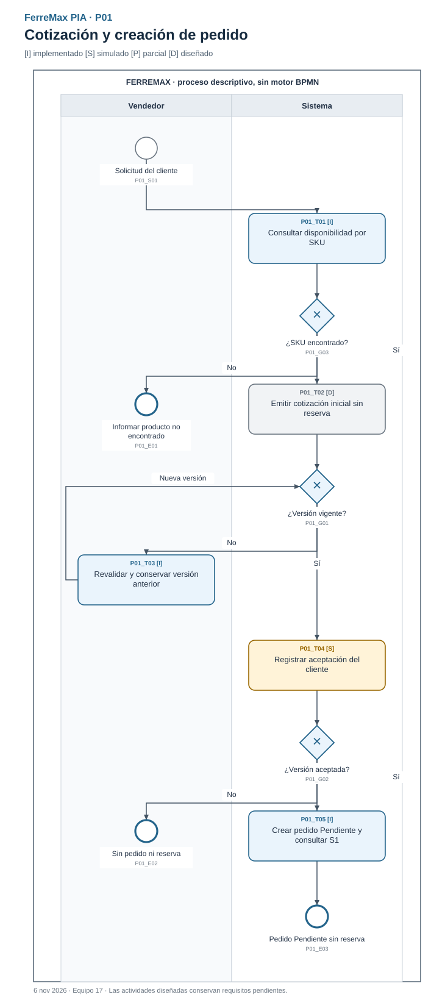
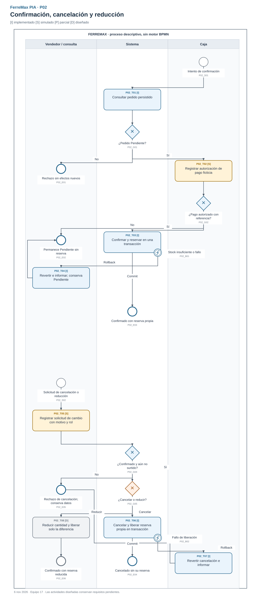
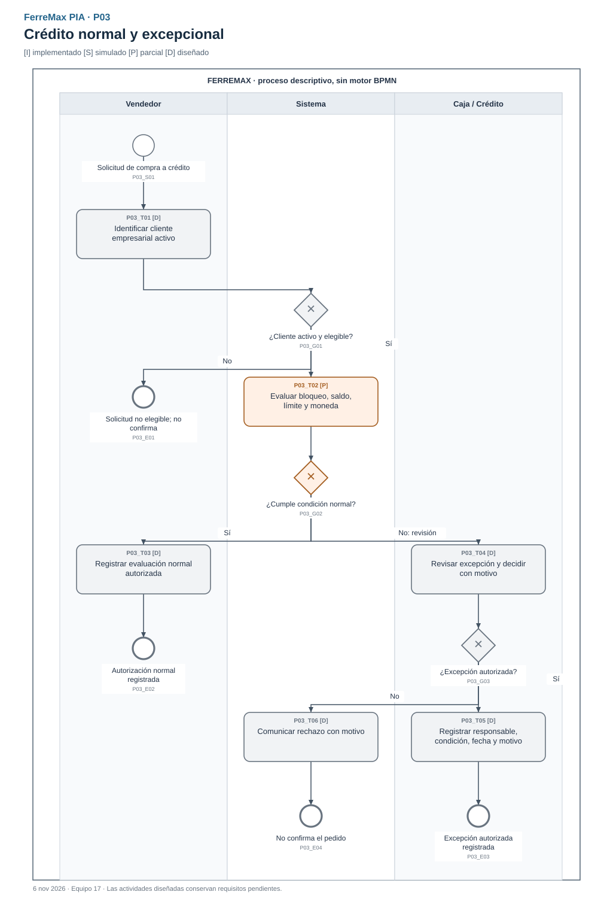
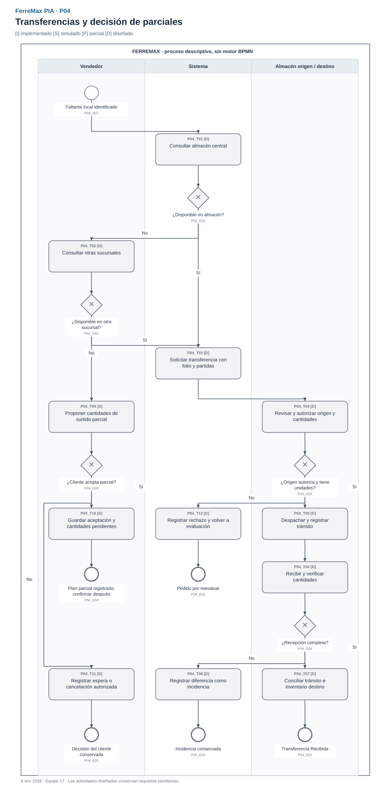
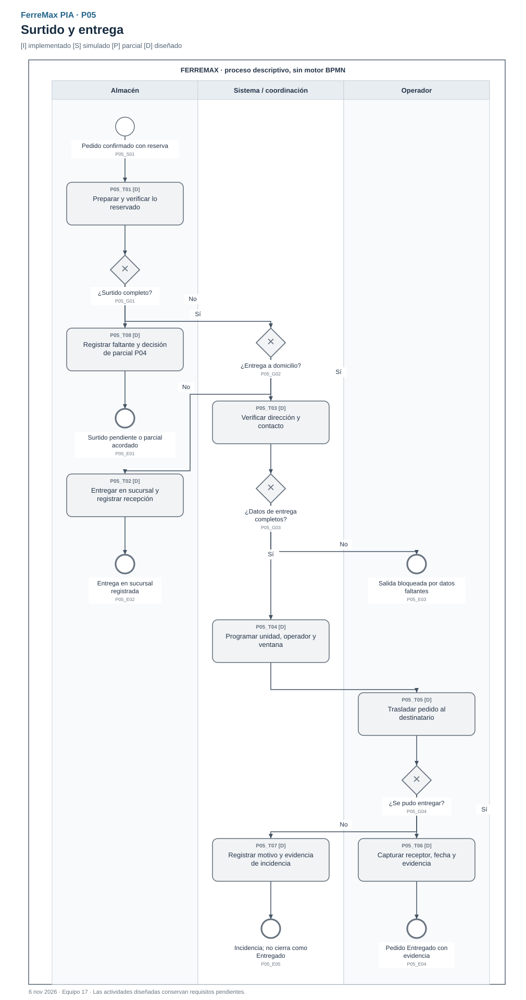
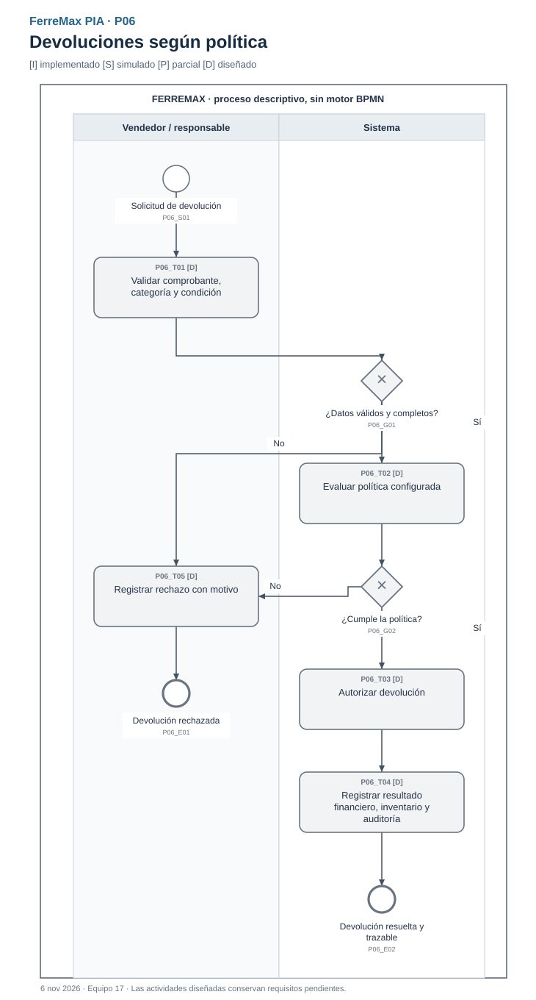
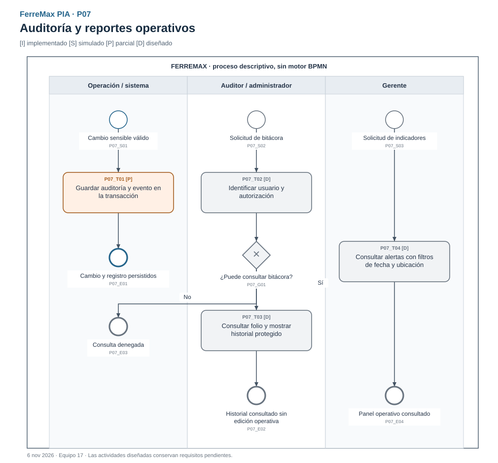

# BPMN integrado - FerreMax PIA

Versión del 6 de noviembre de 2026. Este modelo conserva el proceso del negocio de U2 y lo relaciona con las veinte historias del PIA. El [BRD](../BRD.md), las [historias/Gherkin](USER_STORIES.md) y la [trazabilidad por criterio](trazabilidad_analisis.csv) utilizan los mismos identificadores de actividades.

## Archivo editable y notación

El archivo [ferremax_pia.bpmn](bpmn/ferremax_pia.bpmn) contiene siete procesos descriptivos con sus diagramas BPMN DI, carriles, actividades, compuertas, eventos y flujos. Puede importarse en un modelador que admita BPMN 2.0 y varios diagramas/procesos; los SVG siguientes son las vistas de lectura. La comprobación estructural verifica referencias, conectividad, flujos y coordenadas; no se afirma una importación en un modelador externo que no se realizó.

Todos los procesos tienen `isExecutable="false"`: representan el negocio y el soporte actual de la aplicación. El proyecto usa FastAPI y servicios de aplicación; no utiliza un motor BPMN.

| Elemento | Lectura |
| --- | --- |
| Círculo de trazo delgado | Inicio de una solicitud o situación del negocio. |
| Círculo de trazo grueso | Resultado de ese recorrido; puede ser rechazo, pendiente o éxito. |
| Rectángulo redondeado | Actividad; el XML distingue userTask, serviceTask y businessRuleTask. |
| Rombo con X | Decisión exclusiva; cada salida tiene una condición nombrada. |
| Círculo doble adherido a una tarea | Excepción que interrumpe la actividad; se muestra la reversión transaccional. No representa una nueva transición comercial del pedido. |
| Flecha continua | Orden de actividades dentro del mismo proceso. No se usan flujos de secuencia entre procesos distintos. |
| Carril | Responsabilidad interna de FerreMax. Las decisiones del cliente se reciben y registran; el cliente no se presenta como usuario autenticado del sistema. |

| Marca | Significado |
| --- | --- |
| [I] | Actividad con soporte implementado y prueba identificable en el núcleo. |
| [S] | Entrada o actor simulado en la demostración. |
| [P] | Soporte parcial; no acredita el flujo completo. |
| [D] | Actividad diseñada cuyo caso de uso aún no está implementado. |

Las marcas y el texto, además del color, permiten distinguir el estado de implementación. Un proceso con tareas [D] no puede presentarse como recorrido ejecutable en Swagger.

## Vistas y cobertura del negocio

| Vista | Historias y reglas | Entrada y resultado |
| --- | --- | --- |
| [P01 Cotización y pedido](bpmn/01_cotizacion_pedido.svg) | US01-US05; BR01-BR04 | Solicitud/consulta → cotización/versionado → aceptación → pedido Pendiente sin reserva. Emisión inicial todavía diseñada. |
| [P02 Confirmación, cancelación y reducción](bpmn/02_confirmacion_cancelacion.svg) | US06/US09/US10; BR04-BR06 | Confirmación de contado con pago simulado y reserva atómica. Otra solicitud puede cancelar antes del surtido. Reducción se conserva como rama diseñada. |
| [P03 Crédito normal y excepcional](bpmn/03_credito.svg) | US07/US08; BR09-BR11 | Solicitud → condiciones normales o revisión → decisión registrada. Solo existe una política básica aislada. |
| [P04 Transferencias y parciales](bpmn/04_transferencias_parciales.svg) | US11-US14; BR07/BR08/BR12/BR13 | Faltante local → almacén central/otras sucursales → transferencia o decisión de parcial/espera/cancelación. Diseñado. |
| [P05 Surtido y entrega](bpmn/05_surtido_entrega.svg) | US15-US17; BR05/BR07/BR08/BR14 | Pedido confirmado/reservado → surtido → entrega en sucursal o domicilio → evidencia o incidencia. Diseñado. |
| [P06 Devoluciones](bpmn/06_devoluciones.svg) | US18; BR15/BR16 | Solicitud → comprobante/condición/política → decisión → resultado financiero e inventario trazables. Diseñado. |
| [P07 Auditoría y reportes](bpmn/07_auditoria_reportes.svg) | US19/US20; BR16 | Registro transaccional de cambios y solicitudes de bitácora/panel. El registro existe en el núcleo; consulta protegida y panel pendientes. |

### P01 - Cotización y pedido

`P01_T01` consulta las ubicaciones que tienen inventario del SKU. Si no existen registros, se informa al vendedor. `P01_T02` conserva la emisión inicial como necesidad de US03; en el demo se prepara mediante semilla. `P01_G01` distingue vigencia; `P01_T03` crea una versión nueva y vuelve a evaluarla. `P01_T04` recibe aceptación simulada y `P01_T05` crea Pendiente ligado a la versión, con consulta de S1 y sin reserva.

La vista es de negocio: no exige que una misma petición HTTP ejecute toda la cadena. Revalidar y convertir son operaciones independientes, con sus propios rechazos. Los datos inválidos y errores de infraestructura se documentan en [la API](../api/); no se convierten en estados nuevos del negocio.

### P02 - Confirmación, cancelación y reducción

`P02_T02` representa referencia y autorización ficticias de pago. `P02_T03` guarda estado, reserva, auditoría y evento en una transacción. La excepción `P02_B01` conduce a reversión y conservación del pedido Pendiente; las solicitudes repetidas o con estado inválido no duplican efectos.

La cancelación es una invocación posterior e independiente (`P02_S02`), no una continuación obligatoria de toda venta. `P02_G04` exige Confirmado y aún no surtido. La rama Cancelar llega a `P02_T06`, que libera solo la reserva propia; si falla la liberación se revierte toda la operación. La rama Reducir (`P02_T08`) está diseñada y permanece pendiente. El motivo y la guarda de rol se validan en el servicio; los actores HTTP son simulados.

### P03 - Crédito

La condición normal exige cliente empresarial activo, moneda compatible, ausencia de bloqueo y crédito suficiente. El incumplimiento no autoriza una compra: requiere rechazo o revisión. La excepción registra responsable, fecha, motivo y condición, sin inventar umbrales comerciales. Una autorización de crédito de esta vista es una entrada para una confirmación futura del flujo de crédito; no se presenta como soporte del endpoint actual de contado.

### P04 - Transferencias y parciales

Se consulta primero almacén central y después otras sucursales. La autorización y el despacho conservan origen/destino/cantidades; la recepción concilia tránsito y existencia y mantiene las diferencias como incidencias. Un parcial exige una decisión explícita del cliente y cantidades por partida. Esperar no equivale a tener reserva confirmada; si se cancela un pedido ya reservado, solo se libera lo que corresponde conforme a BR06.

### P05 - Surtido y entrega

El surtido parte de un pedido confirmado y no excede lo reservado. El faltante se registra y se relaciona con la decisión de parcial de P04. La entrega a domicilio exige dirección/contacto y programación de unidad, operador y ventana. Receptor, fecha/hora y evidencia permiten cerrar como entregado; una incidencia conserva otro resultado. Estos estados del diseño no forman parte todavía de la máquina de tres estados del código.

### P06 - Devoluciones

La devolución se evalúa contra comprobante, categoría, condición y política. Un rechazo registra motivo. Una autorización conserva la decisión, el efecto financiero y el destino del inventario; no se supone que todo producto retornado vuelva a disponible. La política comercial sigue sin valores acordados y la vista no impone días, porcentajes ni importes inventados.

### P07 - Auditoría y reportes

La primera rama describe el registro que se realiza **dentro de la transacción del caso de uso**; no agrega un consumidor externo de outbox. Las otras ramas representan solicitudes independientes de consulta de bitácora o panel. Registrar auditoría no acredita autenticación, consulta protegida ni prohibición de edición por un usuario operativo de BD.

## Relación entre las vistas

| Resultado | Proceso relacionado | Condición de enlace |
| --- | --- | --- |
| P01: pedido Pendiente | P02: confirmación | Cliente aceptó una versión vigente; todavía no hay reserva. |
| P02: Confirmado con reserva | P05: surtido | Surtir se limita a cantidades reservadas; el flujo de surtido está pendiente. |
| P02: Confirmado antes del surtido | P02: nueva solicitud de cancelación/reducción | Rol y motivo válidos; reducción pendiente. |
| P03: autorización de crédito | Futura confirmación de crédito | No se fuerza al endpoint actual de contado ni se simula cumplimiento de US07/US08. |
| P04: transferencia recibida | Reevaluación de disponibilidad / plan de surtido | La recepción actualiza inventario; no confirma automáticamente una venta. |
| P04: parcial aceptado | Confirmación/surtido futuros | Se conservan consentimiento y cantidades, sin confundirlos con aceptación de cotización. |
| P05: entrega registrada | P06: solicitud posterior de devolución | No existe devolución automática ni plazo fijado en este análisis. |
| Cambios sensibles de cualquier vista | P07: registro transversal | Cada operación válida conserva auditoría; el núcleo lo hace transaccionalmente. |

Los folios/IDs y las condiciones anteriores relacionan las vistas. No hay flujos de secuencia cruzando pools ni una flecha que omita las validaciones de otro proceso.

## Correcciones respecto al BPMN histórico

1. **Pago antes de reserva:** en U2 se dibujó la reserva antes de seleccionar/autorizar pago. PIA respeta BR01/BR05: Pendiente no reserva y la autorización de contado precede al commit conjunto de confirmación/reserva.
2. **Faltante conserva coherencia:** no se promete un parcial sin consentimiento ni se trata tránsito como disponible. La excepción de stock del núcleo revierte, no crea una nueva transición Confirmado → Pendiente.
3. **Cancelación y reducción diferenciadas:** ambas permanecen en el análisis; solo cancelación tiene API, persistencia y pruebas integrales.
4. **Roles y cierre de entrega:** surtido corresponde a almacén y una incidencia de entrega no se confunde con Entregado.
5. **Cobertura del análisis:** crédito excepcional, recepción con diferencia, devolución, panel y consulta de auditoría tienen vistas explícitas, sin presentarlos como implementados.

El [BPMN original de U2](<../../reference/EQ17FerreMax_BPMN(1).pdf>) permanece intacto. Sus páginas 3 y 4 son ampliaciones del diagrama de la página 2, no procesos diferentes. Se inspeccionaron visualmente para esta integración.
