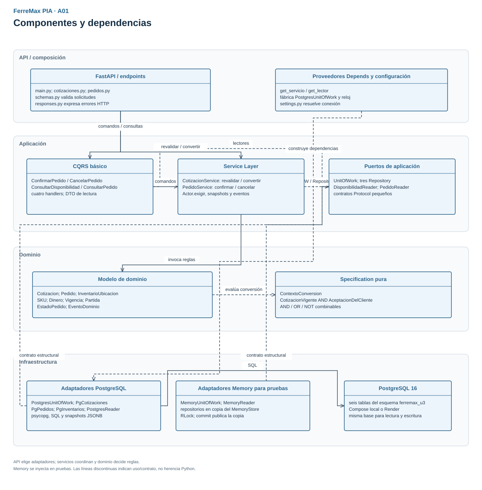
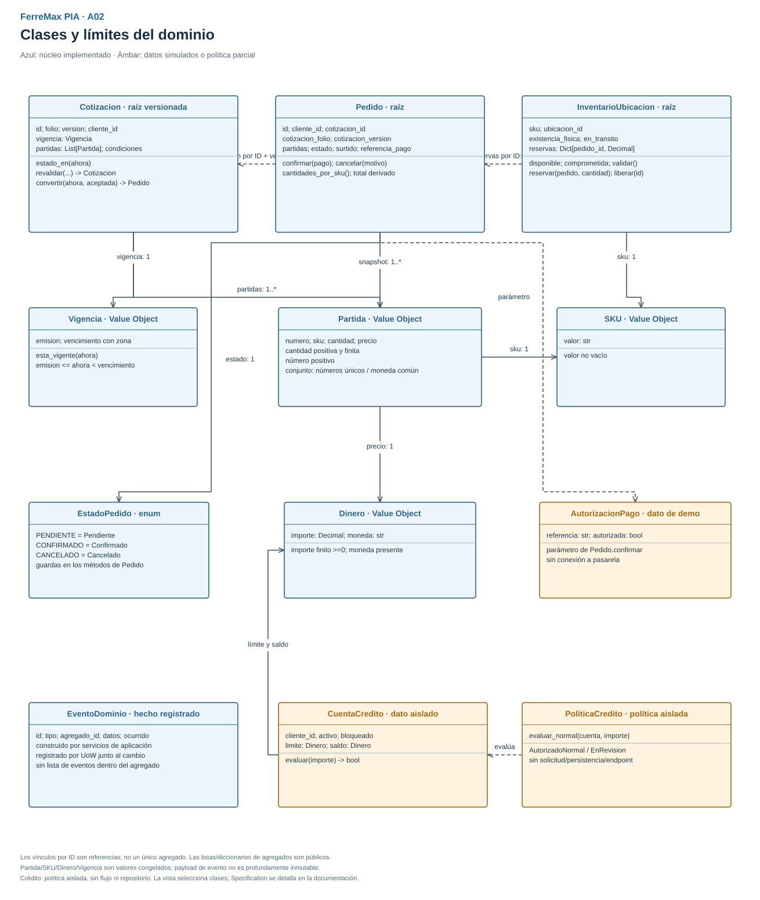
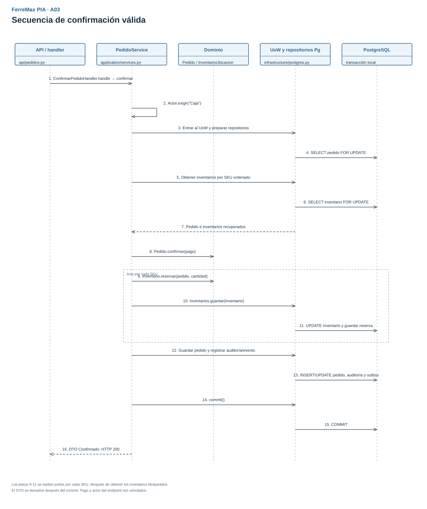
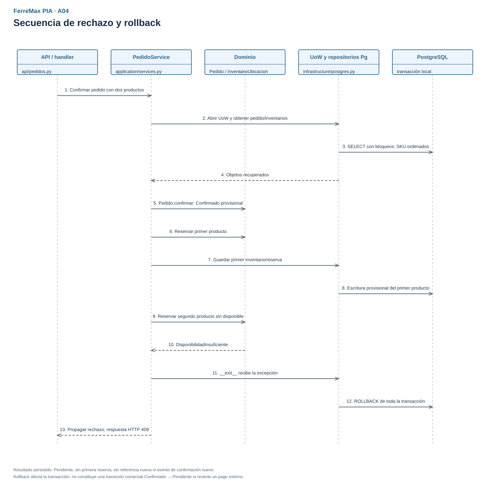
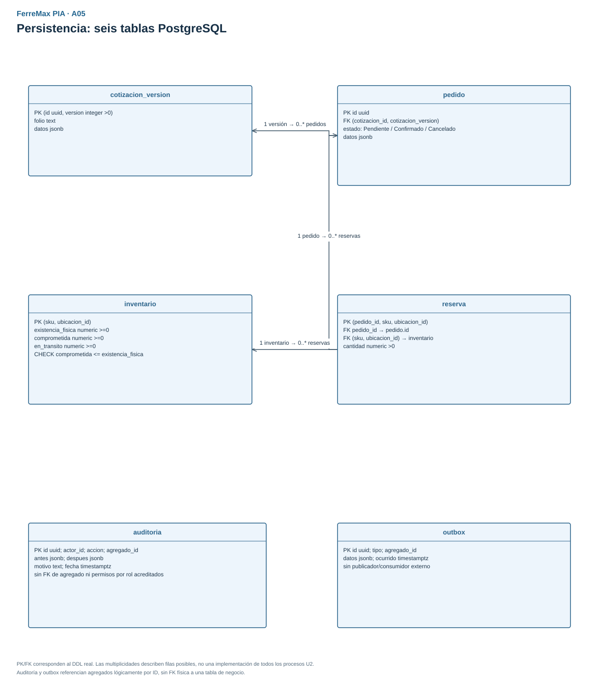

# Diagramas de arquitectura PIA - FerreMax

Estas vistas corresponden al código actual del núcleo y complementan el [BPMN de negocio](../analysis/BPMN.md). Los diagramas históricos U3 permanecen en `diagrams/` y en su informe; las vistas siguientes son la referencia de arquitectura PIA.

**Fuente editable:** [FerreMax_PIA_Arquitectura.drawio](diagrams/FerreMax_PIA_Arquitectura.drawio), con cinco páginas. Abrir/importar el archivo en draw.io y seleccionar A01-A05. El XML de páginas, celdas, conexiones y coordenadas se validó estructuralmente; no se afirma una importación en una aplicación externa que no se realizó. Los SVG se renderizaron e inspeccionaron visualmente.

| Vista | Responsabilidad | Decisiones |
| --- | --- | --- |
| A01 | Componentes, dependencias y punto de composición | ADR-P01/P02/P04/P07 |
| A02 | Clases reales, valores y referencias de agregados | ADR-P01/P05/P06 |
| A03 | Confirmación válida con reserva y commit | ADR-P03/P05 |
| A04 | Fallo de segunda reserva y rollback | ADR-P03 |
| A05 | Seis tablas, claves y relaciones físicas | ADR-P02/P03/P05 |

## A01 - Componentes y dependencias

La API contiene validación y proveedores `Depends`; los servicios usan fábrica de UoW y reloj. Los handlers de comandos delegan al servicio; los lectores tienen contratos separados. Revalidar/convertir invocan directamente al servicio de cotizaciones. Infraestructura cumple contratos por operaciones compatibles, sin herencia obligatoria de Protocol. La API conoce PostgreSQL porque elige el adaptador; el dominio no lo importa. La etiqueta corta **UoW** conecta el servicio con los contratos de trabajo/repositorios que el nodo de puertos enumera.

El dibujo agrupa responsabilidades de una aplicación por capas, no microservicios ni bounded contexts distribuidos. El despliegue Compose/Render se detalla en [la arquitectura](README.md), con su rama seguida y evidencia de CI/CD.

## A02 - Clases y límites del dominio

| Vínculo | Significado |
| --- | --- |
| Cotizacion → Vigencia / Partida | Una vigencia y una o más partidas de la versión. |
| Pedido → Partida | Snapshot de una o más partidas aceptadas, con total derivado. |
| Pedido → Cotizacion, etiqueta ID+v | Referencia de origen por ID y versión; una versión puede originar varios pedidos porque convertir no es idempotente. No es composición del agregado cotización dentro del pedido. |
| InventarioUbicacion → Pedido, etiqueta IDs | El diccionario de reservas referencia cero o más IDs de pedido. La fila física de reserva aparece en A05; no hay clase Python Reserva. |
| Partida → SKU / Dinero | Un SKU y un precio por partida. |
| Pedido → EstadoPedido / AutorizacionPago | Estado almacenado y parámetro de confirmación; la autorización no se conserva como entidad de pago. |
| PoliticaCredito → CuentaCredito | Evaluación básica aislada, sin flujo de solicitud ni persistencia. |

La vista selecciona las clases necesarias para entender el núcleo. Specification y su ContextoConversion se explican en [el modelo](MODELO_DDD.md) y el ADR-P06. `EventoDominio` se construye en los servicios de aplicación y se registra por el UoW; no pertenece a una lista de eventos de cada agregado.

## A03 - Secuencia de confirmación válida

La secuencia agrupa colaboraciones para que se lea el caso: rol, UoW, pedido/inventarios con bloqueo, dominio, escrituras y commit. Los pasos 9-11 forman un loop: cada SKU se reserva y guarda antes del siguiente. El resumen confirmado se devuelve después del commit. El actor y el dato de autorización son simulados; el diagrama no agrega una conexión bancaria.

## A04 - Secuencia de rechazo y rollback

Después de una primera escritura provisional, el dominio rechaza el segundo producto sin unidades. La excepción sale del bloque `with`, el UoW revierte PostgreSQL y la API expresa HTTP 409. Se conserva el pedido **persistido** como Pendiente, sin primera reserva ni efectos de éxito nuevos. No es una transición comercial Confirmado → Pendiente. El mecanismo equivalente de cancelación revierte liberaciones anteriores si falla un producto; se verifica en sus pruebas PostgreSQL aunque esta vista dibuja el caso de confirmación.

## A05 - Persistencia

Las flechas indican FK y el texto describe multiplicidades. Cada pedido referencia exactamente una versión de cotización; esa versión puede ser origen de cero o más pedidos. Una reserva referencia un pedido y un inventario por SKU/ubicación. Inventario o pedido pueden existir sin reserva activa. Auditoría/outbox guardan referencias lógicas de agregado sin FK física al pedido o a cotización.

Los snapshots JSONB contienen partidas, valores y fechas; las columnas tipadas contienen relaciones, estados y cantidades. El DDL no tiene tablas de Producto, Cliente, Usuario ni CuentaCredito. Los diagramas no se presentan como prueba de normalización de esos snapshots ni de permisos de auditoría que no existen.

## Fuentes y reproducción del contenido

- Código: `src/ferremax/domain`, `application`, `infrastructure` y `api`.
- [DDL compartido](../../tests/sql/ferremax_pruebas.sql).
- [Pruebas identificadas por criterio](trazabilidad_arquitectura.csv) y [decisiones](DECISIONES.md).
- El archivo draw.io contiene texto y conexiones editables; los SVG son exportaciones de lectura con el mismo inventario de elementos. No contienen una captura simulada de una ejecución de la API.
