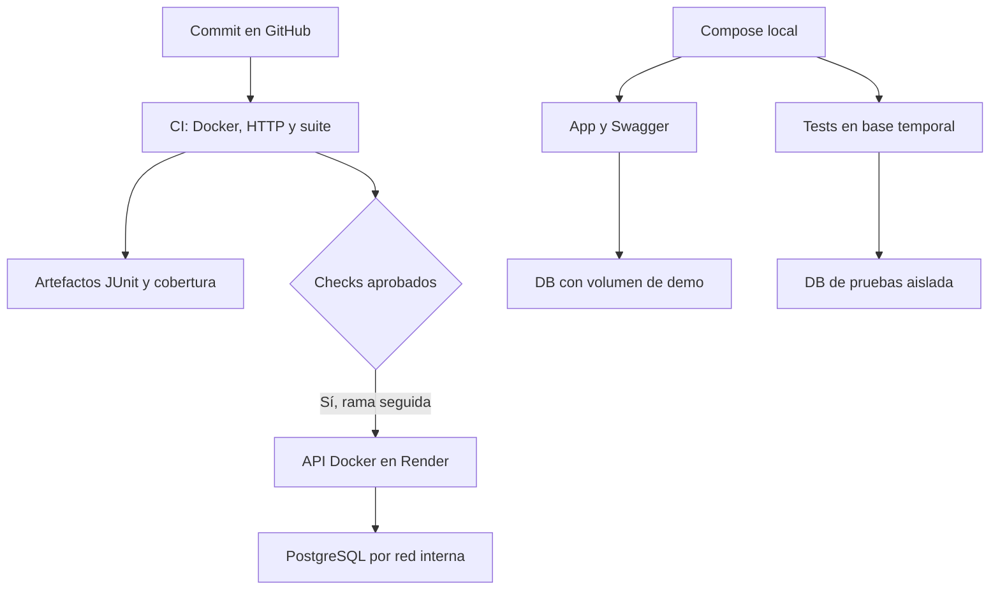

# Arquitectura del PIA de FerreMax

Versión documental del 6 de noviembre de 2026, contrastada con el código de `35145ba`. El bloque actual actualiza documentación; el comportamiento de la API y las evidencias de ejecución conservan su versión identificada.

## Problema que organiza la arquitectura

FerreMax debe evitar convertir cotizaciones vencidas y confirmar pedidos sin mercancía suficiente. Revalidar conserva versiones; confirmar guarda estado y reserva juntos; cancelar libera solo lo propio. Estos casos requieren reglas reutilizables, persistencia consistente y mensajes comprensibles desde una API.

La solución usa un Domain Model, servicios de aplicación, puertos pequeños y adaptadores Memory/PostgreSQL. La API REST compone las dependencias y traduce solicitudes y errores a HTTP. Es una aplicación por capas en un solo servicio; no hay microservicios ni motores de workflow.

| Documento | Contenido |
| --- | --- |
| [Modelo DDD](MODELO_DDD.md) | Clases reales, valores, límites de agregados, eventos y alcance pendiente. |
| [Diagramas PIA](DIAGRAMAS.md) | Componentes, clases, secuencias de éxito/rollback y persistencia; SVG y fuente draw.io. |
| [Patrones y SOLID](PATRONES_SOLID.md) | Justificación con código/pruebas y límites concretos. |
| [Decisiones y ADRs](DECISIONES.md) | Contexto, alternativas, decisión, consecuencias y relación con U3. |
| [Trazabilidad arquitectural](trazabilidad_arquitectura.csv) | Requisito/criterio → componente → vista → decisión → prueba. |
| [Máquina de estados](STATE_MACHINE.md) | Pendiente, Confirmado y Cancelado, guardas y efectos transaccionales. |
| [Contrato de API](../api/README.md) | Seis operaciones, OpenAPI, errores y condiciones para repetir el demo. |

## Capas y composición

| Capa | Responsabilidad y archivos | Dependencias permitidas en esta solución |
| --- | --- | --- |
| Dominio | `domain/model.py` protege valores, vigencia, estados, reserva y crédito básico; `domain/specifications.py` evalúa condiciones puras | Biblioteca estándar y sus propios módulos. No importa FastAPI, psycopg ni adaptadores. |
| Aplicación | `application/services.py` verifica roles y coordina transacciones; `ports.py` define repositorios/lectores/UoW; `cqrs.py` contiene cuatro comandos/consultas y sus handlers | Dominio, contratos y colaboraciones inyectadas. Los servicios reciben fábrica de UoW y reloj. |
| Infraestructura | `infrastructure/postgres.py` implementa repositorios, UoW y lector; `memory.py` ofrece dobles de persistencia para pruebas | Dominio y bibliotecas técnicas. Implementa contratos por compatibilidad estructural; no exige herencia explícita de Protocol. |
| API / composición | `api/main.py`, `cotizaciones.py`, `pedidos.py`, `schemas.py`, `settings.py`, `responses.py` | FastAPI/Pydantic, aplicación y adaptadores elegidos. Aquí es correcto conocer PostgreSQL para construir las dependencias externas. |

Confirmar/cancelar y las dos consultas usan handlers CQRS. Revalidar/convertir llaman directamente a `CotizacionService`; la documentación no supone un handler adicional por cada endpoint. Las pruebas reemplazan dependencias de FastAPI para usar Memory y reloj fijo; la API desplegada usa PostgreSQL.

Los servicios se programan contra operaciones esperadas de sus colaboradores; sus fábricas no están anotadas estáticamente con todos los Protocol. La separación se comprueba en los imports, el cableado y las pruebas de comportamiento; no se atribuye al proyecto una verificación estática de tipos que no existe.

## Un recorrido de escritura

En confirmación, el endpoint valida UUID, referencia, booleano de autorización y ubicación. Construye `Actor("caja-api-demo", "Caja")` y el comando. `PedidoService` exige rol, entra al UoW, obtiene el pedido con bloqueo y obtiene inventarios en orden de SKU. El dominio valida origen Pendiente/pago y disponibilidad. Cada inventario se guarda; después se guardan pedido, auditoría y evento y se ejecuta un único commit.

Si falla una partida, `PostgresUnitOfWork.__exit__` hace rollback de todas las escrituras. El pedido persistido sigue Pendiente, incluso si el objeto local ya cambió provisionalmente a Confirmado. No se afirma que el rollback reponga mágicamente cada objeto Python ni que revierta un pago externo. El pago de este prototipo es simulado.

La cancelación bloquea el pedido, conserva su estado anterior, valida Confirmado/no surtido/motivo y localiza su única ubicación de reserva. Libera las reservas por SKU, guarda el pedido y registra auditoría/evento en la misma transacción. Una inconsistencia al liberar el segundo producto revierte la primera liberación y el estado.

## Persistencia y concurrencia

Las seis tablas de `ferremax_u3` son `cotizacion_version`, `pedido`, `inventario`, `reserva`, `auditoria` y `outbox`; el nombre del esquema se conserva para no romper datos ni SQL. El [DDL único](../../tests/sql/ferremax_pruebas.sql) es compartido por pruebas, Compose y arranque inicial de Render.

| Mecanismo | Qué garantiza / límite |
| --- | --- |
| `SELECT ... FOR UPDATE` en pedido e inventario | Serializa escritores sobre las filas afectadas. Los SKU se recorren ordenados para reducir órdenes de bloqueo incompatibles. No es un bloqueo global de toda la empresa. |
| PK `(id, version)` de cotización | Dos revalidaciones concurrentes no insertan dos veces la misma siguiente versión. La lectura de cotización no usa `FOR UPDATE`; la colisión de inserción se rechaza y revierte. |
| Restricciones de inventario y reserva | Cantidades no negativas, comprometida <= física y reserva >0; FK al pedido y al inventario. La consistencia entre reservas y comprometida la mantiene la transacción del servicio/adaptador, no un trigger que no existe. |
| JSONB y columnas de relación | Conserva snapshots de objetos y columnas de clave/estado/cantidades para relaciones y consultas. No se usa un ORM. |
| Lector PostgreSQL `READ ONLY` | Las consultas de disponibilidad/pedido no guardan cambios. Comparte la misma base de escritura. |
| `lock_timeout` de 5 s en UoW | Limita espera de bloqueos del caso; no acredita por sí mismo los objetivos de rendimiento RNF01. |
| Memory con copia y `RLock` | Permite verificar reglas/rollback en proceso y publicar cambios al commit. No reproduce la implementación de bloqueos de PostgreSQL ni sustituye su prueba de integración. |

Auditoría/outbox no tienen FK a una sola tabla de agregado: almacenan un identificador lógico y datos del hecho. No se dibujan relaciones físicas inexistentes. La aplicación no entrega todavía mensajes a un consumidor externo ni tiene API de bitácora.

## Despliegue y automatización

Compose contiene `db`, `app` y `tests`; App corre sin usuario root. La suite crea y elimina solo su propia base temporal y conserva reportes. En CI, cada runner tiene DB/volumen ficticios y desechables; su limpieza no afecta la base local ni Render.

Render utiliza `DATABASE_URL` por red interna, `PORT` y flags de inicialización/carga. El arranque inicializa DDL bajo bloqueo asesor y carga datos con inserciones que conservan lo existente. Es preparación idempotente del esquema actual, no un sistema general de migraciones de versiones.

La configuración final de `render.yaml` sigue `main` y espera checks aprobados. `pia-entrega` conserva la rama de preparación del cierre. El [registro de versiones](../pia/VERSIONES.md) y la evidencia de cierre identifican la integración y el despliegue realmente verificados. Los commits exclusivamente documentales pueden incluir `[skip render]` y siguen sujetos al CI.

## Evidencia y límites del alcance

La [verificación de CI/CD](../../evidencias/pia/render_cd_verificacion.json) identifica `947aeae`: 242 pruebas aprobadas, 0 omitidas y cobertura 97.24%, seguidas de despliegue automático y consulta de datos conservados. El [OpenAPI](../api/openapi.json) corresponde a la API 0.6.0 y sus seis operaciones; se contrastó con `create_app().openapi()` al actualizar esta arquitectura.

Autenticación, pasarela, crédito integral, emisión inicial operativa, reducción, multiorigen, transferencias, parciales, surtido, entrega, devolución y panel tienen límites descritos en el [BRD](../BRD.md) y la [matriz](../pia/MATRIZ_CUMPLIMIENTO.md). Las vistas PIA distinguen código real y diseño pendiente. Los originales de `reference/`, `diagrams/`, `docs/adr/` y los PDF U3 se conservan como antecedentes consultables mediante `u3-entrega`.
