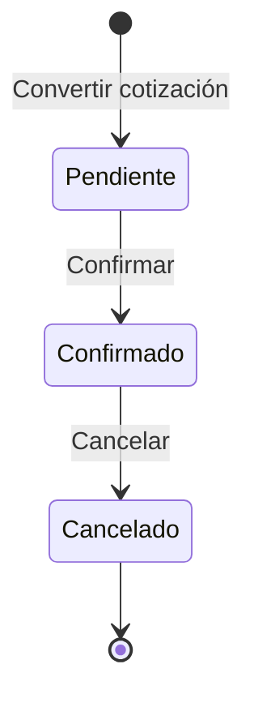

# Máquina de estados de pedidos de FerreMax

## Alcance y responsabilidad

La máquina actual usa el enum `EstadoPedido` y las guardas de
[`Pedido.confirmar()` y `Pedido.cancelar()`](../../src/ferremax/domain/model.py).
Los métodos verifican el estado de origen y sus condiciones antes de cambiarlo.
Esta implementación corresponde al flujo de contado y una ubicación por pedido
del núcleo ejecutable PIA. La conversión de una cotización aceptada crea el pedido en
`Pendiente`; no reserva inventario.

[`PedidoService`](../../src/ferremax/application/services.py) verifica el rol y
coordina estado, inventario, auditoría y eventos en una transacción. El dominio
decide las transiciones del pedido; el servicio decide cuándo confirmar el
conjunto de cambios mediante el Unit of Work.

## Diagrama



Las flechas están sujetas a las guardas y a la confirmación transaccional
descritas abajo. `Cancelado` es terminal para las operaciones del prototipo.
Los intentos rechazados conservan el estado y no son nuevas transiciones.

## Matriz completa de estados y acciones

| Estado actual | Acción | Resultado con condiciones válidas |
| --- | --- | --- |
| Pendiente | Confirmar | Confirmado; reserva inventario. |
| Pendiente | Cancelar | Rechazo; permanece Pendiente. |
| Confirmado | Confirmar | Rechazo; permanece Confirmado, sin duplicar reserva. |
| Confirmado | Cancelar | Cancelado; libera la reserva propia. |
| Cancelado | Confirmar | Rechazo; permanece Cancelado. |
| Cancelado | Cancelar | Rechazo; permanece Cancelado, sin liberar de nuevo. |

## Guardas, transacción y trazabilidad

| Operación | Condiciones y efectos | Referencia |
| --- | --- | --- |
| Crear pedido | Cotización vigente y versión aceptada; crea Pendiente. Las condiciones se evalúan con Specification. | BR02/BR03; US04/US05. |
| Confirmar | Rol Caja, origen Pendiente, autorización de pago con referencia y disponibilidad suficiente. Guarda Confirmado, reserva, auditoría y `PedidoConfirmado` en una transacción. | BR04/BR05; US09. |
| Cancelar | Rol VendedorAutorizadoCancelacion, origen Confirmado, aún no surtido y motivo no vacío. Guarda Cancelado, libera su reserva, audita y registra `PedidoCancelado`. | BR06; US10. |

Si falta inventario, el Unit of Work revierte también el cambio de estado y la
referencia de pago. El pedido almacenado permanece Pendiente, sin reservas
parciales ni evento de confirmación. Ese rollback no es una transición comercial
`Confirmado → Pendiente`: es una operación que no llegó a confirmarse.

El indicador `surtido` es una guarda de cancelación. Este prototipo no incluye
una operación de surtido ni agrega un estado Surtido, Entregado o Devuelto.
La presentación del PIA debe distinguir este alcance de los procesos más amplios
que figuran en el análisis de FerreMax.

## Verificación

[`tests/test_state_machine.py`](../../tests/test_state_machine.py) recorre los
tres estados por las dos acciones: seis combinaciones. Cada estado se prepara
mediante operaciones reales de los servicios, con datos nuevos por caso.

Las rutas permitidas comprueban estado, inventario y un solo evento/auditoría
adicional, con los estados anterior y posterior correctos. Las prohibidas
comparan todos los datos contra su copia anterior. Se prueban además pago
rechazado, referencia vacía, motivo vacío, pedido surtido y roles incorrectos.

E9 complementa esta matriz con el límite de disponibilidad, liberación de la
reserva propia, cancelación repetida y rollback. Sus pruebas de PostgreSQL
verifican persistencia, concurrencia y reversión de una reserva parcial.

```bash
python -m pytest tests/test_state_machine.py tests/test_e9_inventario.py tests/test_e9_cancelacion.py -v
```

Este comando verifica el bloque con Memory. Para verificar también PostgreSQL,
la suite completa usa una base de pruebas separada. La opción reproducible es `docker compose run --build --rm tests`, que la prepara automáticamente. Una prueba omitida no acredita integración. Ver [arquitectura PIA](README.md) y [CI](../CI.md).
